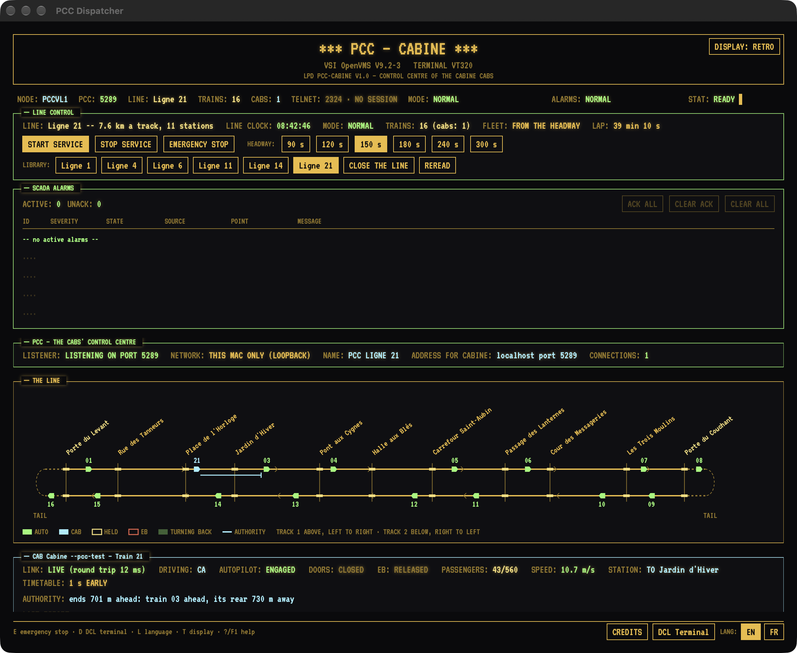
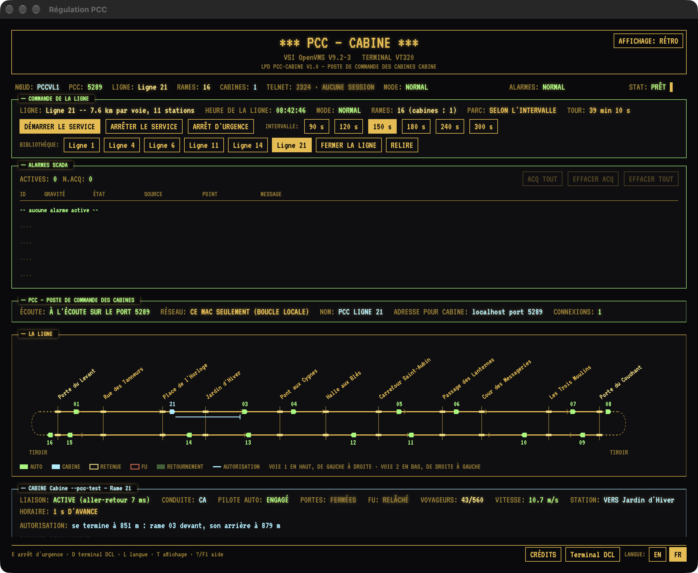
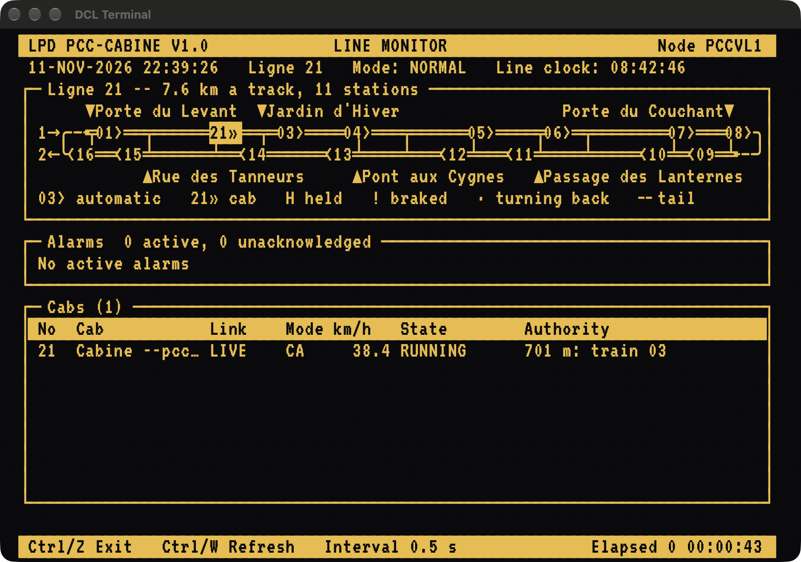

# cabinePCC

cabinePCC is the control centre (PCC, poste de commande centralisé) of **Cabine**, the metro driving
simulator seen from the cab. A Cabine in PCC mode no longer works out the other trains of its line, nor
its own movement authority: it dials a PCC, and the PCC is the simulation behind every cab connected to
it. This is that PCC: a native macOS app in a retro VT320 and OpenVMS dress, with an operator's desk in a
window, a DCL shell that really controls the engine, and a tool that runs the same PCC with no window at
all.

It keeps a library of lines, runs the one its operator puts it on, drives the automatic trains, keeps
every train apart in moving block, gives each cab its movement authority, and takes the operator's
orders: hold a train, brake it, send its driver a message, stop the line. The lines are the PCC's: a cab
that does not hold the line the PCC is on is sent it.

English | Français
:---:|:---:
 | 

## How it stands to Cabine and to metroSystem

- **Cabine** is the other end of the link, and has no public repository at this writing. The wire the
  two speak is set out in [docs/cabine-link.md](docs/cabine-link.md), and that page is the contract
  between them: anything that speaks it can be a cab. The headless tool has scripted cabs of its own, so
  the PCC can be seen at work without a Cabine:
  `cabinepcc-headless --cabs 2 --settle 20 --dcl "MONITOR LINE"`.
- **[metroSystem](https://github.com/douglas-carmichael/metroSystem)** is where the look and the shell
  come from. cabinePCC borrows its retro theme, its
  terminal emulator and its DCL engine (the OpenVMS emulation, EDT, MAIL, command procedures, HELP, the
  SMG and DECforms-style screens, the SCADA alarm log), and is otherwise its own program: it has none of
  metroSystem's railway. No Lille loop, no VAL or PRATIC backends, no Modbus, no peer network.
- **The engine** is the package in [Engine/](Engine/README.md). It drives its trains with a port of
  Cabine's own automatic driver and train motion, and keeps them apart by Cabine's own moving-block rules
  and figures, which every line package carries. It is not Cabine's source files compiled in.

## Build and run

The Xcode project is generated by [XcodeGen](https://github.com/yonaskolb/XcodeGen) from `project.yml`
and is not kept in git. [DCLixKit](https://github.com/douglas-carmichael/dclix_swift) is a git submodule.

```sh
git clone --recurse-submodules https://github.com/douglas-carmichael/cabinePCC
cd cabinePCC
git submodule update --init          # if it was cloned without them
xcodegen generate
xcodebuild -project CabinePCC.xcodeproj -scheme CabinePCC -configuration Debug \
  -destination 'platform=macOS' build
xcodebuild -project CabinePCC.xcodeproj -scheme cabinepcc-headless -configuration Debug \
  -destination 'platform=macOS' build
```

The targets are macOS 15, Swift 5.9 language mode, App Sandbox off, signed ad hoc. One instance of the
app runs on a Mac at a time: a second launch says so and quits.

When the app launches it starts its services at once, from its application delegate, whether or not a
window appears: the PCC on TCP port 5289, advertised by Bonjour as `_cabinepcc._tcp`, and the DCL shell
over telnet on port 2324, on loopback. It reads its library, takes up the line it was last on (Cabine's
invented Ligne 21 the first time), and runs it. A Cabine in PCC mode dials it: its Settings are given
this Mac's address and that port (`127.0.0.1:5289` on the same Mac, which is what Cabine proposes).
Cabine does not browse for a PCC: the Bonjour advertisement is there for a client that does. `SHOW PCC`
says which port, since another is taken when 5289 is in use.

What it keeps is under `~/Library/Application Support/CabinePCC/`: `COM/` for command procedures and the
mailbox, `DCLix/` for the system-management layer, and `Lines/` for the operator's own lines. Its
settings are in its own preferences domain, `net.dcarmichael.CabinePCC`.

Arguments at launch, each for that launch alone:

| | |
|---|---|
| `-pcc.lan NO` | The PCC listens on this Mac only, whatever the setting says |
| `-pcc.name "name"` | The PCC's name |
| `-openDCL` | Opens a DCL Terminal beside the PCC Dispatcher |
| `-dcl "command"` | Opens one, and types that command in it: `-dcl "MONITOR LINE"` |
| `-node NAME`, `-user NAME` | Name the node and its operator, in place of the Mac and its user |
| `-theme iso` | Starts in the ISA-101 display |
| `-AppleLanguages "(fr)"` | Starts in French, as for any Mac app |

## The windows

- **PCC Dispatcher**, the main window: the operator's desk. A banner and a status strip; the line's
  controls (service, the general emergency stop, the headway) with the library, a button for each line
  the PCC holds; the SCADA annunciator, with acknowledgement and clearing as ISA-18.2 has them; and
  beneath them, scrolling, the PCC and its listener, a diagram of the line's two tracks with every train
  on them, a card for each cab with its orders (hold, release, emergency brake, message, call), the
  connections, the trains, the journal, and the library with where each line's data came from. The foot
  opens the other windows and switches language (English, French) and display (retro, ISA-101). Keys: `?`
  or F1 for the help, `L` for the language, `T` for the display, `D` for a DCL Terminal, `E` for the
  general emergency stop, `Q` to quit.
- **DCL Terminal**, any number of them: an OpenVMS DCL shell on a VT320, each window its own session.
  Here it is on `MONITOR LINE`, the line as a mimic board, with a cab in service as train 21:



## The DCL at a glance

The shell is the emulation metroSystem has, with a layered product of its own, **LPD PCC-CABINE**. Every
command reads or orders the engine through the same link the window uses; [docs/dcl.md](docs/dcl.md)
has each with its grammar and a sample of its output.

| | |
|---|---|
| `SHOW PCC`, `SET PCC /ENABLE /DISABLE /LAN= /NAME=` | The listener, the network, the name |
| `SHOW LINES`, `SHOW LINE [/STATIONS] [/SOURCE]` | The library; the line the PCC is on |
| `SET LINE /LOAD=id`, `/CLOSE`, `/REREAD` | Which line |
| `SET LINE /SERVICE= /EMERGENCY= /HEADWAY= /RAMES=` | The line's orders |
| `START LINE`, `STOP LINE`, `EMERGENCY`, `RESUME` | Service on and off; the general emergency stop |
| `SHOW RAMES`, `SHOW RAME n`, `SHOW CABS` | The trains; one in full; the cabs |
| `SET RAME n /HOLD /RELEASE /BRAKE /UNBRAKE /MESSAGE= /CALL` | The orders for one train |
| `SHOW CONNECTIONS`, `SHOW JOURNAL [/LAST=n]` | Every connection; what has happened |
| `SHOW ALARMS`, `ACKNOWLEDGE`, `SHELVE`, `UNSHELVE` | The SCADA alarm log |
| `MONITOR LINE`, `CABS`, `RAMES`, `CONNECTIONS` | Live displays: the line as a mimic board, the cabs, the trains, the link |
| `RUN RAME_DIR`, `RUN LIGNE_DIR` | DECforms-style forms: the trains and cabs with their orders; the line library |
| `F$PCC(item)`, `F$RAME(n,item)` | Lexical functions, so that a command procedure can read the engine |

The railway's words follow the language of the session, and only that language's spelling is accepted:
`LINE` and `LIGNE`, `CABS` and `CABINES`, `/HOLD` and `/RETENIR`, `EMERGENCY` and `URGENCE`. What is
printed is in that language too. OpenVMS's own output and the HELP library stay English, as on a real
system.

```
$ SET RAME 21 /HOLD /MESSAGE="WAIT FOR THE DEPARTURE SIGNAL"
%PCC-S-HOLD, train 21 is held at its platform, or at the next it reaches
%PCC-S-MESSAGE, message sent to the cab of train 21
$ SET LINE /LOAD=4
%PCC-W-REFUSED, A cab is in service on the present line: the PCC changes line only when none is.
```

`SELFTEST` drives every documented verb once, dry, and `HELP` documents each: 229 of 229 at this
writing. A command procedure reads the engine with `F$PCC` and `F$RAME` and tells what became of an order
from `$STATUS`; `WAITCAB.COM`, in the command store, waits for a cab and holds it.

## The headless tool

`cabinepcc-headless` is built by the same project from the same core, and has no window.

```sh
cabinepcc-headless --serve [--port n] [--telnet n] [--loopback] [--line id] [--name "name"] [--store folder]
cabinepcc-headless --selftest
cabinepcc-headless --dcl "SHOW LINES" --dcl "MONITOR LINE"
```

- `--serve` runs the PCC and the telnet DCL until it is interrupted. It is a real way to run the PCC: on
  a Mac with nobody at it, or beside a Cabine on the same Mac.
- `--selftest` runs the DCL's `SELFTEST` in both languages, then a PCC for scripted cabs over loopback,
  and checks verb by verb that the DCL reads and orders the engine, that every alarm is raised and
  returns to normal, and that every monitor and form draws: 370 checks at this writing. Its exit status
  is 0 when every one passes. It touches nothing of the user's. It does not check the windows.
- `--dcl` carries out commands against a fresh node and prints what a terminal would show; a command
  that takes over the screen prints one frame of it. The samples in the documentation are made with it:
  `Scripts/makedocs.sh` runs it for each of them and makes [docs/dcl.md](docs/dcl.md) from what it
  printed.

[docs/architecture.md](docs/architecture.md) has the options in full.

## Layout

```
project.yml                 the XcodeGen project: the app, and the headless tool
Sources/CabinePCC/Core/     what both targets compile: the node, the link, the DCL engine, the strings
Sources/CabinePCC/App/      the app's entry point and its views
Sources/Headless/           the tool's entry point, its self-test and its scripted cab
Engine/                     the engine package (CabinePCCKit), and its own daemon
DCLixKit/                   the system-management layer of the shell (submodule)
Lines/                      the library the program is built with: six line packages
Resources/                  the VT323 typeface, the icon, the entitlements
Scripts/                    makeicon.swift draws the icon; checkstrings.py checks the string table;
                            makedocs.sh makes docs/dcl.md from dcl.template.md (filldocs.py fills it)
docs/                       the wire, the DCL, the architecture, the lines
```

## The lines' data

The five real lines of the library are built from open data: OpenStreetMap (© OpenStreetMap
contributors, ODbL 1.0), Île-de-France Mobilités and the IGN (Licence Ouverte 2.0). The packages name
their sources, the app shows them, and [docs/lines.md](docs/lines.md) sets them out. Nothing of the
RATP's is used but the names and numbers of its lines and stations. The RATP has not approved cabinePCC,
and nothing here says or suggests that it has.
